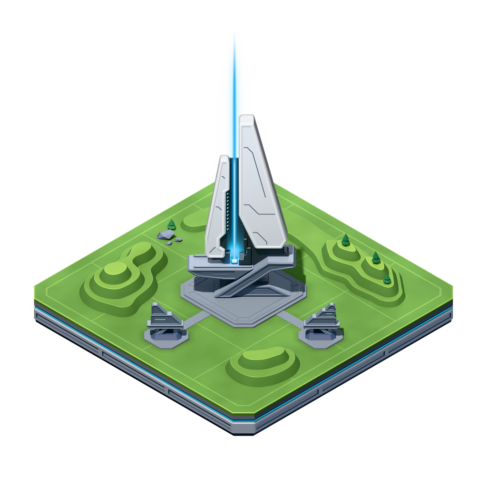
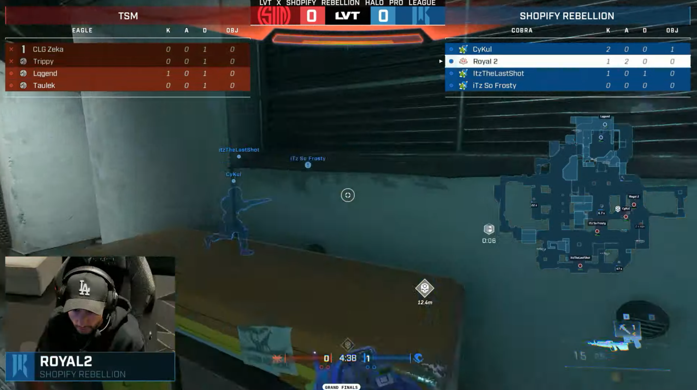
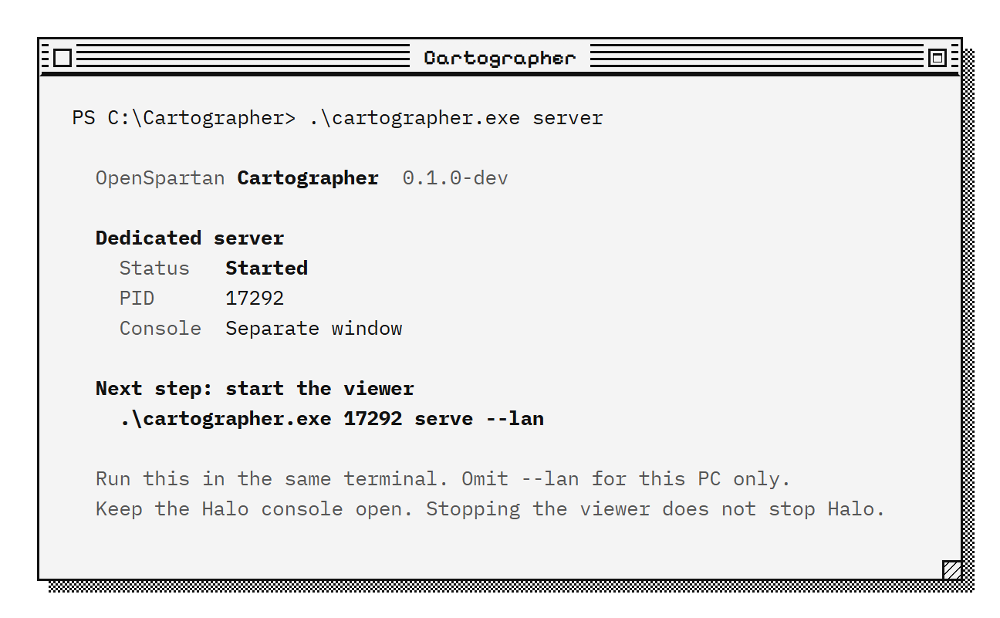
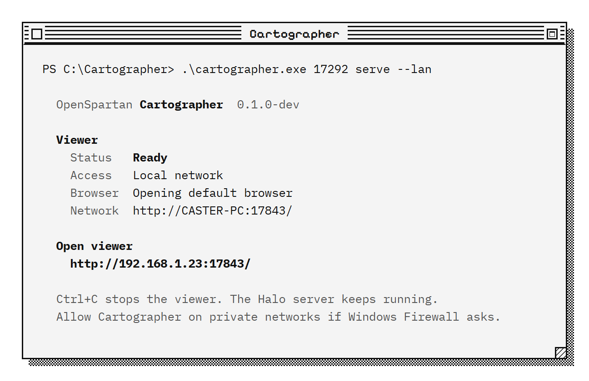
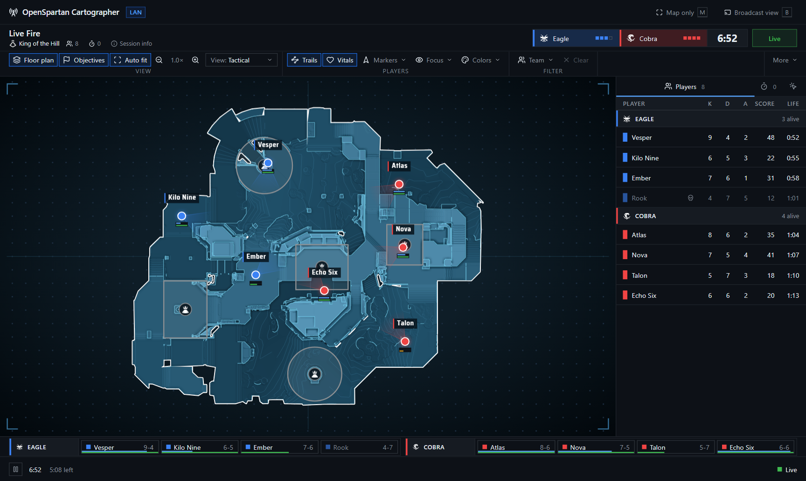

<p align="center">
  
</p>

<h1 align="center">Cartographer<br></h1>

<p align="center">A live map of Halo Infinite LAN matches, for broadcasters.</p>

<p align="center">
  
  <a href="LICENSE"></a>
</p>

Cartographer runs beside a Halo Infinite LAN server and shows the match as it happens: where every player is and where they aim, their health and shields, the score and clock, the mode's objectives, and when each weapon and power-up respawns. The operator view is for whoever runs the show, and the broadcast and map-only layouts are made for the stream.

> [!NOTE]
> Cartographer is experimental. Use it at your own risk. It supports one build of the game, Steam 269225.26.04.08.1618. It isn't endorsed or supported by Microsoft or Halo Studios.

## On stream



Cartographer's map was on the broadcast of the [LVT Halo Grand Finals](https://youtu.be/sEzdt56fZZQ?t=25524). Thanks to [Okom](https://okom.one/) for connecting us with the LVT Halo team, so we could test-drive it with them and push improvements at the speed of light.

## How it works

Cartographer reads the memory of the LAN dedicated server running on the same PC and serves what it reads as a web page. It only reads, and only from the dedicated server: it never opens the game client, which runs under Easy Anti-Cheat, and it refuses any server process that Windows doesn't let it read.

## Requirements

- 64-bit Windows.
- The Steam version of Halo Infinite, on the PC that hosts the LAN server.

## Quick start

1. Download the ZIP from the [latest release](https://github.com/OpenSpartan/cartographer/releases/latest) and extract it.
2. Open PowerShell in the extracted folder. To start the LAN server and the viewer at the same time, paste:

   ```powershell
   .\cartographer.exe server; if ($?) { .\cartographer.exe serve --lan }
   ```

   It starts the LAN server, then the viewer, which finds the server by itself. In PowerShell 7, `.\cartographer.exe server && .\cartographer.exe serve --lan` does the same.

> [!NOTE]
> If Halo Infinite is installed in a non-standard location, see [The LAN server](#the-lan-server).

You can also start the LAN server from the game's LAN menu, then start only the viewer:

```powershell
.\cartographer.exe serve --lan
```

Either way, the viewer opens in your browser.

> [!NOTE]
> `--lan` lets other PCs on your network connect and see the viewer too (see [Share it on your network](#share-it-on-your-network)). Without it, the viewer runs on its default port at http://127.0.0.1:17843/, and only this PC can open it.

Press <kbd>Ctrl</kbd>+<kbd>C</kbd> to stop the viewer. The LAN server will keep running.

### Step by step

`server` starts the LAN server and prints its process ID:



`serve` then starts the viewer for that server:

```powershell
.\cartographer.exe 17292 serve --lan
```



> [!NOTE]
> You don't need to give `serve` the process ID. Leave it out, and Cartographer finds the running LAN server by itself. You only need it when more than one LAN server is running.

## The LAN server

Cartographer watches a LAN server on the same PC. There are three ways to start one, and Cartographer can read the first two. Run one server at a time.

### From the game's menus

1. In a Halo Infinite lobby set to **LAN** (not Xbox Live), choose **Launch LAN Server**. The server starts in its own console window.
2. Start the viewer: `.\cartographer.exe serve --lan`.

### With Cartographer

`cartographer.exe server` starts the game's LAN dedicated server in its own console window, directly, as the game's LAN menu does. Players join it like any other LAN server. Close its console window to stop it. The server doesn't stop when Cartographer exits, so the viewer can be stopped and started again at any time.

- It finds Halo Infinite through Steam's install record. For another location, give the install folder (not its `game` subfolder): `.\cartographer.exe server --game "E:\SteamLibrary\steamapps\common\Halo Infinite"`.
- `--dry-run` checks the install and prints how it would start the server, without starting it.
- It won't start while another process holds the game port, and it never stops or replaces a running process. With it running, don't also press **Launch LAN Server** in the game.
- Steam counts the game as running while a server runs, so if you'll also play on this PC, start Halo Infinite first.
- If the terminal doesn't let processes outlive it, starting fails. Run `server` from a regular PowerShell window instead.

### With Steam launch options

In Steam, open Halo Infinite's **Properties**, and under **General**, set **Launch Options** to `-server -lan`. **Play** then starts a LAN server instead of the game, until you clear them.

> [!WARNING]
> A server Steam starts from launch options (`-server -lan`) can't be read. Steam starts it through the game's anti-cheat launcher, so Easy Anti-Cheat protects it like the game itself, and the viewer reports **Blocked**.

### Joining

However the server started, the host then picks **Create Match** in the game and chooses the server, which carries the name of the PC it runs on. Players on other PCs can join it from the LAN list only after that.

## The viewer

| Page | Shows |
|---|---|
| `/` | The operator view: map, players, spawn timers and controls. |
| `/?layout=broadcast` | A score strip over the map, scaled to the screen height. |
| `/?layout=map` | The map alone. Add `&bg=transparent` for an OBS browser source. |



The viewer runs in your browser, and its toolbar lets you customize the view: the floor plan and objectives, trails and vitals, how players are marked, a player or team to focus on, team and floor colors, and more. **Focus** keeps the map on one player.

### Keys

| Key | Does |
|---|---|
| <kbd>M</kbd> | Switches to the map-only layout and back. |
| <kbd>B</kbd> | Switches to the broadcast layout and back. |
| <kbd>T</kbd> | In the map-only layout, turns the transparent background on and off. |
| <kbd>1</kbd> to <kbd>9</kbd> | Picks the observed player by number (see [The observed player](#the-observed-player)). |
| <kbd>0</kbd> | Clears the observed player. |
| <kbd>Esc</kbd> | Clears the observed player, or with nobody observed, goes back to the layout you came from. |
| <kbd>Space</kbd> | In the operator view, pauses the feed and starts it again. |

In OBS, keys reach a browser source through **Interact**.

### Page options

These options go after any page address, joined with `&`. Each one is kept in the address as you change it in the toolbar, so OBS can be given the same address as the view you set up.

| Option | Does |
|---|---|
| `bg=transparent` | Drops the page background in the map-only layout, so the map sits over your scene. |
| `alpha=0` to `255` | With `bg=transparent`, the floor plan's opacity. The default is `255` (opaque), and `0` leaves only players and pads. |
| `floorcolor=` | The map floor's color: `blue`, `slate`, `teal`, `green`, `sand`, `violet`, `graphite`, or any color as six hex digits (`floorcolor=2f7fc1`). |
| `team1=` to `team8=` | A team's color, one of Halo Infinite's team colors: `carrot`, `tangelo`, `salmon`, `vermillion`, `cottoncandy`, `cerise`, `lavender`, `aubergine`, `sky`, `cerulean`, `jade`, `mint`, `grass`, `lime`, `sunshine`, `pineapple`. |
| `vitals=off` | Hides health and shields under the map markers. |
| `labels=numbers` or `labels=names` | Marks each player on the map with a number instead of a name, or the other way round. The map-only layout uses numbers unless you ask for names, and the other layouts use names. |
| `marker=arrow` | Makes each player's marker point where they aim. |
| `firing=trace` or `firing=off` | Adds a dashed line along a shooter's aim, or shows nothing when players fire. |
| `contrast=high` | Sets every marker on a dark band edged in white, so it stands out on any floor or scene. |
| `orientation=` | Which way up the map is: `y` or `x` (that world axis points up the screen), `-y` or `-x` (it points down), a quarter turn apart. Left out, each map is turned to fit the view, the same way in every mode. |
| `observed=` | The number of the player the game's observer is watching, such as `observed=3`. |
| `view=data` | Draws the map data instead of the minimap: what each part of the floor is. For checking a map, not for a stream. |

For example, this address shows only the map on a transparent background, with the floor plan slightly see-through, the floor in slate, the teams in vermillion and cerulean, and players as numbered arrows:

```text
http://127.0.0.1:17843/?layout=map&bg=transparent&alpha=200&floorcolor=slate&team1=vermillion&team2=cerulean&marker=arrow
```

### Markers

**Markers** in the toolbar sets how players show on the map, in the look broadcast minimaps use.

- **Labels**: names on tags above the players, or numbers in their markers. Numbers follow the roster: the first team is 1 to 4, the next 5 to 8, and so on for more or bigger teams. A player keeps theirs for the whole match, and the roster, the legend and the broadcast strip show the same numbers.
- **Markers**: discs with a soft cone along each player's aim, or arrows, a teardrop that points where the player aims with their number in its round end.
- **Shots**: a player who fires gets short lines round their marker. **Lines and trace** adds a dashed line along their aim to the first player in its way, or to the first wall, where a short bar ends it. A shot goes on over low cover, a drop or the floor below. Shots show only when the server reports them.
- **High contrast** sets every marker on a dark band edged in white, which stands out on light and dark floors alike.

In the map-only and broadcast layouts the markers grow with the map, so they keep their size against it on any screen.

### The observed player

Cartographer can't tell which player the game's observer is watching, so you tell it. Press the player's number, <kbd>1</kbd> to <kbd>9</kbd>, or click their marker and choose **Observe** on their card. Their marker gets a white ring and a beam of light along their aim, and their square in the roster and the legend is ringed in white. The map stays where it is, unless you also focus on them. <kbd>0</kbd> or <kbd>Esc</kbd> clears it. The numbers are the same whether the map shows numbers or names. While nobody is observed, the focused player gets the beam.

### Colors

**Colors** sets each team's color, from Halo Infinite's team colors, and the map floor's, one of the presets or any color from the picker. The floor is shaded from dark to light in the color picked.

### Save image

**Save image**, at the end of the toolbar or under **More**, saves the floor plan as a PNG with a transparent background, for stream graphics or a Forge map's portfolio. It keeps the map, elevation, orientation and colors shown, terrain and all, leaves out players, pads and objectives, and is 2048, 4096 or 8192 pixels on its longer side. Every elevation of a map frames the same area, so its floors line up as layers. The file is named after the map variant in play, or the map picked in **Map**, and the elevation: `live-fire-ranked.png`, `live-fire-ranked-4m.png`.

## Share it on your network

By default only this PC can open the viewer. To let other PCs on the same network open it, such as a co-caster's or an OBS machine, add `--lan`:

```powershell
.\cartographer.exe serve --lan
```

Cartographer prints the address to share, such as `http://192.168.1.23:17843/` or `http://CASTER-PC:17843/`, and opens it in your browser. The page options above work on it too. If Windows Firewall asks whether to allow Cartographer, allow it on **private** networks. With more than one network adapter, `--lan 192.168.1.23` picks the adapter with that address.

> [!WARNING]
> Anyone on the network can then see the match, including names, positions and scores, so use `--lan` only on networks you trust.

## Floor plans

A studio map's floor plan shows where players can go in the mode being played. The map data leaves out the areas a map closes in that mode, such as Live Fire's far interior and Streets' side alleys outside Infection, floors nobody reaches, such as rooftops, and stray floors outside the map. The viewer picks the plan for the mode the server is running and switches when the mode changes. A map picked in the **Map** menu shows the plan most modes share.

### Forge maps

A Forge map has no floor plan of its own. Cartographer draws the navmesh baked into the map's published files instead, one plan per map variant, picked by the variant the server is running. A Forge map without a plan shows players and pads on a blank floor.

### The map's look

Every studio map, and the Forge maps played competitively, is drawn from its terrain: the map seen from above, lighter where it is higher, with contour lines on slopes and buildings drawn with their roofs and crisp edges. The terrain keeps to the floor plan's outline, so ground players can't reach stays off the map, and a white edge runs round it. A map without a terrain is drawn in height bands with the same white edge.

**Elevation** slices the map at a height, from its lowest floor to its highest. The terrain within a storey of that height keeps its full look, the floors below it stay faint, and those above it are cut away to a trace, so a floor under a roof or a walkway shows through.

## Parameters

```text
cartographer.exe [pid] serve [port] [--lan [address]] [--no-browser]
cartographer.exe server [--game <install folder>] [--dry-run]
cartographer.exe [pid] status
cartographer.exe [pid] snapshot
cartographer.exe [pid] capture [seconds]
cartographer.exe [pid] navmesh <out.json> [--blob <file>]
cartographer.exe --version
cartographer.exe --help
```

| Parameter | Does |
|---|---|
| `pid` | The process ID of the LAN server to read, before the command. Left out, Cartographer finds the server by itself. With more than one LAN server running, give the one to show first, such as `.\cartographer.exe 5983 serve`. |
| `serve` | Starts the viewer and opens it in your browser. |
| `port` | The viewer's port, `17843` by default, such as `.\cartographer.exe serve 17850`. |
| `--lan [address]` | Lets other PCs on your network open the viewer, through every network adapter or only the one with the given IPv4 address (see [Share it on your network](#share-it-on-your-network)). |
| `--no-browser` | Keeps the browser closed. |
| `server` | Starts the game's LAN dedicated server (see [The LAN server](#the-lan-server)). |
| `--game <install folder>` | Halo Infinite's install folder, not its `game` subfolder, when Steam's install record doesn't point to it. |
| `--dry-run` | Checks the install and prints how `server` would start the server, without starting it. |
| `status` | Checks that Cartographer can read the server, and prints what it sees or why it can't. |
| `snapshot` | Prints what Cartographer reads from the server, once, as JSON. |
| `capture [seconds]` | Saves what Cartographer reads from the server for 60 seconds, or for the given 1 to 3600, to a `logs` folder in the current folder. |
| `navmesh <out.json>` | Experimental. Saves the loaded map's floor plan, read from the server's navigation mesh during a match. `--blob <file>` also saves a Forge map's navmesh as the server holds it. |
| `--version` | Prints Cartographer's version. |
| `--help` | Prints the commands and their options. |

## Troubleshooting

| The viewer says | Meaning |
|---|---|
| **Waiting** | No LAN server is running on this PC. |
| **Blocked** | A LAN server is running, but Cartographer can't read it. The viewer says why. The usual cause is a server Steam started from launch options (see [The LAN server](#the-lan-server)). |
| **Offline** | The page can't reach Cartographer: it was stopped, or the network dropped. |

`.\cartographer.exe status` checks from the terminal that Cartographer can read the server, and prints the same reason when it can't.

## License

Cartographer is released under the [MIT License](LICENSE).
